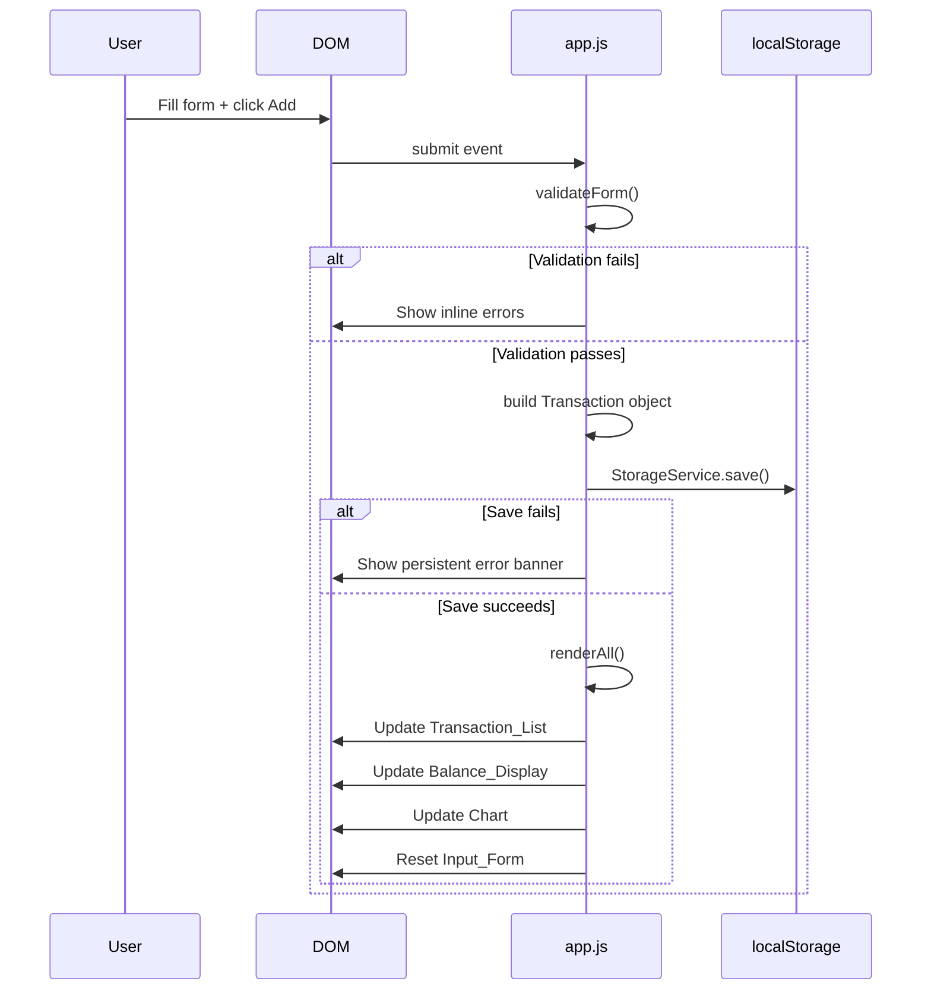

# Design Document

## Overview

The Expense & Budget Visualizer is a single-page web application (SPA) that runs entirely in the browser with no backend. It is built from three files: `index.html`, `css/style.css`, and `js/app.js`. [Chart.js](https://cdn.jsdelivr.net/npm/chart.js) is loaded via CDN for pie-chart rendering. All transaction data is persisted in the browser's `localStorage` API.

The app lets users record expense transactions (name, amount, category), view them in a scrollable reverse-chronological list, see their running total balance, and visualise category spending as a pie chart. All four UI areas update reactively whenever data changes, without page reloads.

### Key Design Decisions

- **No framework / no build tool**: Plain ES2020 module-style code in a single `app.js`. Event-driven, imperative rendering keeps the mental model simple.
- **Single source of truth**: The canonical state lives in `localStorage`. The in-memory `transactions` array is always rebuilt from storage on load and kept in sync on every mutation.
- **Chart.js update strategy**: A single `Chart` instance is created on first render. Subsequent data changes call `chartInstance.data = …; chartInstance.update()` rather than `destroy()` + `new Chart()`, avoiding canvas flicker and the "canvas already in use" error.
- **`Intl.NumberFormat`** is used for all currency formatting to get correct thousands separators and decimal places without manual string manipulation.
- **Defensive storage wrapper**: All `localStorage` calls are wrapped in a `StorageService` with try/catch so the app degrades gracefully when storage is blocked (private-browsing quota limits, security policies).

---

## Architecture

The application follows a **layered event-driven architecture** within a single JavaScript file.

```
┌─────────────────────────────────────────────────┐
│                  index.html (DOM)                │
│  Input_Form │ Balance_Display │ Transaction_List │
│                    Chart Canvas                  │
└────────────────────┬────────────────────────────┘
                     │ DOM Events
                     ▼
┌─────────────────────────────────────────────────┐
│               app.js — Event Layer               │
│  Form submit handler │ Delete click handler      │
└────────────────────┬────────────────────────────┘
                     │ calls
                     ▼
┌─────────────────────────────────────────────────┐
│           app.js — State / Business Logic        │
│  addTransaction() │ deleteTransaction()          │
│  validateForm()   │ formatCurrency()             │
└────────┬──────────┴──────────────────────────────┘
         │ reads/writes            │ triggers
         ▼                         ▼
┌──────────────────┐   ┌──────────────────────────┐
│  StorageService  │   │     Render Layer          │
│  (localStorage   │   │  renderAll()              │
│   wrapper)       │   │  renderTransactionList()  │
└──────────────────┘   │  renderBalance()          │
                        │  renderChart()            │
                        └──────────────────────────┘
```

### Data flow for adding a transaction

1. User fills form and clicks **Add**.
2. `handleFormSubmit` calls `validateForm()` — errors are shown inline and the function returns early on failure.
3. On success, a `Transaction` object is constructed and `addTransaction(tx)` is called.
4. `addTransaction` pushes to the in-memory array, calls `StorageService.save()`, then calls `renderAll()`.
5. `renderAll()` invokes `renderTransactionList()`, `renderBalance()`, and `renderChart()` in sequence.
6. The form is reset.

### Data flow for deleting a transaction

1. User clicks the delete button on a list entry.
2. A native `confirm()` dialog asks for confirmation.
3. On confirmation, `deleteTransaction(id)` is called.
4. The in-memory array is filtered, `StorageService.save()` is called, then `renderAll()`.

---

## Components and Interfaces

### StorageService

Encapsulates all `localStorage` interactions. Throws never — callers receive `null` / `false` on failure.

```js
StorageService = {
  STORAGE_KEY: 'expense_transactions',

  // Returns parsed array or null on failure
  load(): Transaction[] | null,

  // Returns true on success, false on failure
  save(transactions: Transaction[]): boolean,
}
```

**Failure modes handled:**
- `localStorage` unavailable (private mode, security policy) → `load()` returns `null`, `save()` returns `false`.
- Stored JSON is corrupt → `JSON.parse` throws, caught, returns `null`.
- Write failure (quota exceeded) → `setItem` throws, caught, returns `false`.

---

### Validator

Pure functions that inspect form field values. Return `null` on success or an error-message string on failure.

```js
Validator = {
  validateName(value: string): string | null,
  validateAmount(value: string): string | null,
  validateCategory(value: string): string | null,
}
```

Validation rules:
| Field | Rules |
|---|---|
| name | Non-empty after trim; ≤ 100 characters |
| amount | Non-empty; parseable as float; > 0; ≤ 999999999.99; ≤ 2 decimal places |
| category | Must be one of `"Food"`, `"Transport"`, `"Fun"` |

---

### Transaction Manager (state functions)

Global in-memory array `let transactions: Transaction[] = []` plus mutation helpers:

```js
addTransaction(tx: Transaction): void
deleteTransaction(id: string): void
loadFromStorage(): void   // called once on DOMContentLoaded
```

`loadFromStorage` initialises `transactions` from `StorageService.load()`. If the return value is `null`, `transactions` stays `[]` and a persistent warning banner is shown.

---

### Render Layer

Four pure-render functions that read from the `transactions` array and update the DOM. They are always called together via `renderAll()`.

```js
renderAll(): void
renderTransactionList(): void   // updates #transaction-list
renderBalance(): void           // updates #balance-display
renderChart(): void             // updates Chart.js instance
```

**`renderTransactionList`** builds a `<ul>` of `<li>` items in reverse index order (newest first). Each item contains the name, formatted amount, category badge, and a delete `<button>`. When `transactions` is empty it inserts a single empty-state `<p>`.

**`renderBalance`** sums all amounts with `Array.reduce`, formats via `formatCurrency()`, and sets `textContent`.

**`renderChart`** aggregates amounts by category, then either:
- Updates `chartInstance.data.labels`, `chartInstance.data.datasets[0].data`, and calls `chartInstance.update()` if an instance already exists.
- Creates a new `Chart` instance on the `<canvas>` element on first call.
- Shows a placeholder `<p>` overlay and hides the canvas when all category totals are zero.

---

### Currency Formatter

```js
function formatCurrency(amount: number): string
```

Uses `Intl.NumberFormat('en-US', { style: 'currency', currency: 'USD', minimumFractionDigits: 2, maximumFractionDigits: 2 })`. Handles negative numbers natively (e.g., `-$50.00`).

---

## Data Models

### Transaction

The single domain object stored in `localStorage` as a JSON array.

```js
{
  id: string,        // crypto.randomUUID() or Date.now().toString() fallback
  name: string,      // 1–100 characters, trimmed
  amount: number,    // float, positive, 0.01–999999999.99, ≤ 2 decimal places
  category: string,  // "Food" | "Transport" | "Fun"
  createdAt: number, // Unix timestamp ms, Date.now()
}
```

**Storage key**: `"expense_transactions"` in `localStorage`.

**Serialisation format**: `JSON.stringify(Transaction[])` / `JSON.parse(string)`.

### CategoryConfig

A static lookup used by the chart and category badges. Not persisted.

```js
const CATEGORY_CONFIG = {
  Food:      { color: '#FF6384', label: 'Food'      },
  Transport: { color: '#36A2EB', label: 'Transport' },
  Fun:       { color: '#FFCE56', label: 'Fun'       },
}
```

Fixed colours guarantee that the same category always renders with the same colour for the lifetime of the page session (Requirement 5.5).

---

### File Structure

```
project-root/
├── index.html          # Single HTML file — structure + CDN scripts
├── css/
│   └── style.css       # All styles — layout, responsive, accessibility
└── js/
    └── app.js          # All logic — storage, validation, state, rendering
```

`index.html` loads Chart.js from CDN (`https://cdn.jsdelivr.net/npm/chart.js`) and then `js/app.js` as a `defer` script.

---

## Mermaid Diagram — Component Interaction



---

## Correctness Properties

*A property is a characteristic or behavior that should hold true across all valid executions of a system — essentially, a formal statement about what the system should do. Properties serve as the bridge between human-readable specifications and machine-verifiable correctness guarantees.*

### Property 1: Valid transaction persists and appears in list

*For any* valid transaction input (non-empty name ≤ 100 chars, amount in 0.01–999,999,999.99 with ≤ 2 decimal places, category in {Food, Transport, Fun}), after calling `addTransaction`, the transactions array retrieved from `StorageService.load()` SHALL contain an entry whose name, amount, and category match the input.

**Validates: Requirements 1.2, 6.2**

### Property 2: Whitespace-only or empty name is rejected

*For any* string composed entirely of whitespace characters (spaces, tabs, newlines) or the empty string, `Validator.validateName` SHALL return a non-null error string, and the transactions array SHALL remain unchanged.

**Validates: Requirements 1.4**

### Property 3: Amount boundary validation

*For any* numeric string that is zero, negative, greater than 999,999,999.99, or has more than 2 decimal places, `Validator.validateAmount` SHALL return a non-null error string.

**Validates: Requirements 1.5**

### Property 4: Balance equals sum of all amounts

*For any* non-empty array of transactions with arbitrary amounts, the balance value computed by the app SHALL be numerically equal to the arithmetic sum of all transaction amounts, formatted as currency with the correct sign.

**Validates: Requirements 4.1, 4.2, 4.3, 4.5**

### Property 5: Transaction list renders in reverse chronological order

*For any* non-empty array of transactions with distinct `createdAt` timestamps, the rendered transaction list SHALL present entries such that the entry with the highest `createdAt` value appears first, and the entry with the lowest `createdAt` value appears last.

**Validates: Requirements 2.1**

### Property 6: Every rendered transaction entry has a delete control

*For any* non-empty transactions array, every item rendered in the Transaction_List SHALL contain exactly one delete control (a button element).

**Validates: Requirements 3.1**

### Property 7: Delete removes transaction from storage

*For any* transactions array and any transaction `t` in that array, after `deleteTransaction(t.id)`, `StorageService.load()` SHALL return an array that does not contain any entry with `t.id`.

**Validates: Requirements 3.3, 6.2**

### Property 8: Storage round-trip preserves all transaction fields

*For any* array of valid transactions, calling `StorageService.save(transactions)` followed immediately by `StorageService.load()` SHALL return an array of objects with identical `id`, `name`, `amount`, `category`, and `createdAt` fields as the original.

**Validates: Requirements 6.1, 6.2**

### Property 9: Currency formatter produces correct format for all valid sums

*For any* finite number (positive, negative, or zero) representable as the sum of valid transaction amounts, `formatCurrency` SHALL return a string that starts with `$` (or `-$` for negatives), contains a thousands separator for values with an absolute value ≥ 1,000, and ends with exactly two decimal digits.

**Validates: Requirements 4.1, 4.4, 4.5**

### Property 10: Chart segments cover exactly the active categories with distinct colors

*For any* transactions array, the set of labels in the pie chart data SHALL be exactly the set of categories that have at least one transaction (no more, no fewer), and each category label SHALL be assigned a unique color value not shared by any other category.

**Validates: Requirements 5.1, 5.5**

---

## Error Handling

| Scenario | Detection | User-Visible Response |
|---|---|---|
| Form field empty on submit | `Validator.*` returns string | Inline `<span class="error">` beneath the offending field; form not submitted |
| Amount out of range / bad precision | `Validator.validateAmount` | Same inline error pattern |
| `localStorage` unavailable on init | `StorageService.load()` returns `null` | Persistent warning banner (yellow) above form; app starts with empty list |
| `localStorage.setItem` throws on save | `StorageService.save()` returns `false` | Persistent error banner (red); UI reverts to previous state (transaction not added/removed) |
| `JSON.parse` fails on stored data | Caught in `StorageService.load()` | Same as "unavailable on init" — empty start + warning |
| Transaction delete fails in storage | `StorageService.save()` returns `false` after filter | Error banner; transaction stays in list (state reverted) |
| Chart canvas missing from DOM | Guard `if (!canvas) return` in `renderChart` | Silent no-op; rest of UI unaffected |

---

## Testing Strategy

Because this is a pure client-side vanilla JS application with no build tools or test runner setup, the testing strategy is designed around what can be manually verified in the browser and what can be expressed as automated property-based and unit tests if a runner is added later.

### Unit Tests (Example-Based)

Focus on pure functions that have no DOM or storage dependencies:

- `Validator.validateName`: empty string, whitespace-only, 100-char boundary, 101-char over-limit, valid name.
- `Validator.validateAmount`: zero, negative, `0.005` (3 decimal places), `999999999.99` (valid max), `1000000000` (over max), non-numeric string.
- `Validator.validateCategory`: each valid category, empty string, arbitrary invalid string.
- `formatCurrency`: `0` → `"$0.00"`, `1234.56` → `"$1,234.56"`, `-50` → `"-$50.00"`, `999999999.99` → `"$999,999,999.99"`.
- `StorageService.load` with mocked `localStorage`: valid JSON array, corrupt JSON, unavailable storage.
- `StorageService.save` with mocked `localStorage`: success, quota-exceeded throw.

### Property-Based Tests

If a property-based testing library such as [fast-check](https://fast-check.dev/) is added, each design property maps to one parameterised test:

- **Feature: expense-budget-visualizer, Property 1**: Generate arbitrary valid transactions → `addTransaction` → `StorageService.load()` → assert entry present with matching fields.
- **Feature: expense-budget-visualizer, Property 2**: Generate whitespace-only and empty strings → `Validator.validateName` → assert non-null error string.
- **Feature: expense-budget-visualizer, Property 3**: Generate zero, negative, over-limit, and >2-decimal amounts → `Validator.validateAmount` → assert non-null error string.
- **Feature: expense-budget-visualizer, Property 4**: Generate arrays of transactions → compute expected sum → compare with balance value output.
- **Feature: expense-budget-visualizer, Property 5**: Generate non-empty transaction array → verify rendered list order matches reverse sort by `createdAt`.
- **Feature: expense-budget-visualizer, Property 6**: Generate non-empty transaction array → render list → assert every item contains a delete button element.
- **Feature: expense-budget-visualizer, Property 7**: Generate array + random element → `deleteTransaction` → `StorageService.load()` → assert element id absent.
- **Feature: expense-budget-visualizer, Property 8**: Generate arrays of valid transactions → `StorageService.save` → `StorageService.load` → assert deep equality of all fields.
- **Feature: expense-budget-visualizer, Property 9**: Generate valid numeric sums (positive, negative, zero) → `formatCurrency` → assert format invariants (prefix, separator, decimal places).
- **Feature: expense-budget-visualizer, Property 10**: Generate transactions array → derive chart labels and colors → assert label set equals non-zero category set and all colors are distinct.

Each property-based test should run a minimum of 100 iterations.

### Integration / Manual Smoke Tests

These require a running browser and cannot be unit-tested:

- Page load populates list, balance, and chart from stored data.
- Adding a transaction updates all three areas within 1 second.
- Deleting a transaction with confirmation updates all three areas.
- Dismissing the delete confirmation leaves the list unchanged.
- Simulating `localStorage` block (private mode) shows the warning banner.
- Responsive layout: resize DevTools viewport to 320 px and 1920 px, confirm no horizontal scroll.
- Keyboard navigation: Tab through all controls; confirm visible focus indicators.
- Screen reader check: all labeled regions announced correctly.
